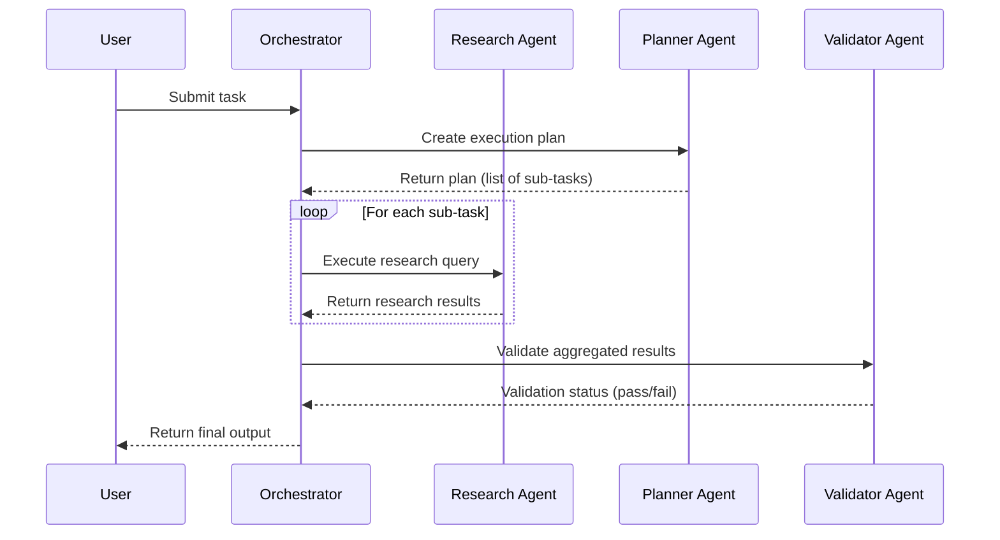
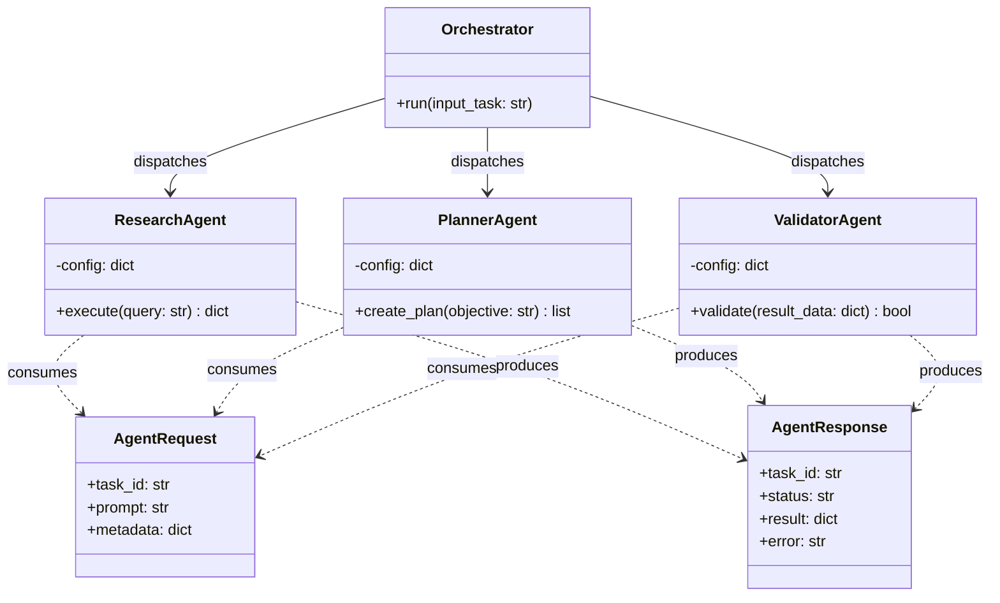
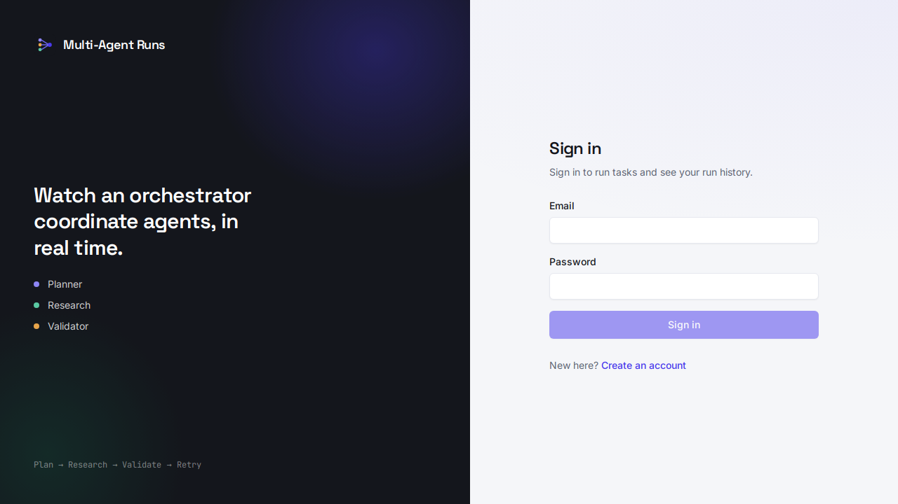
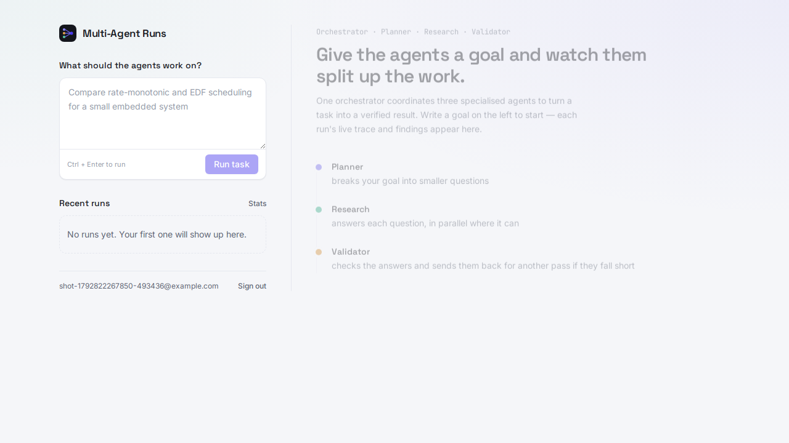
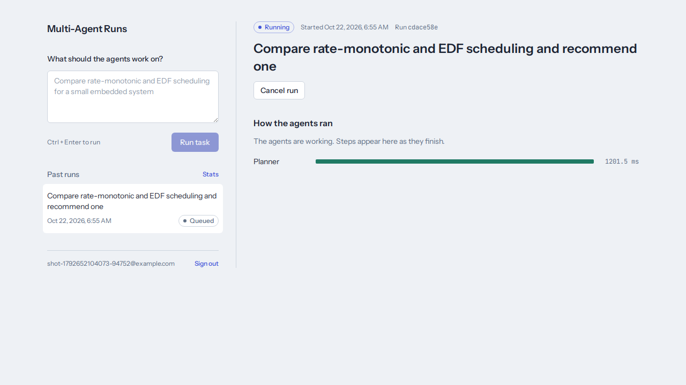
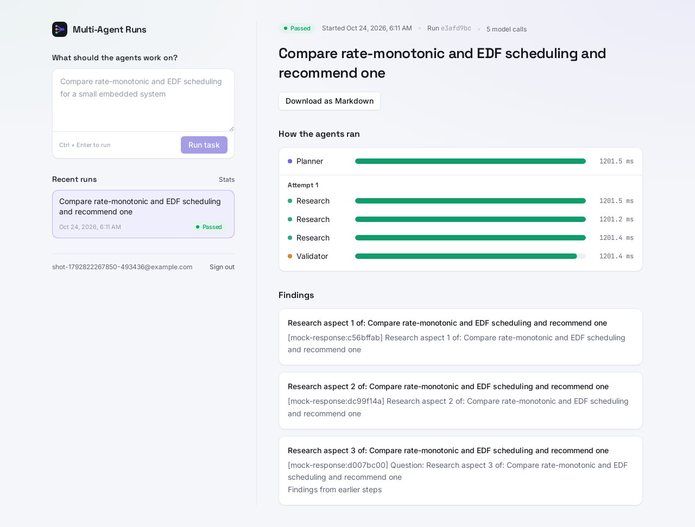
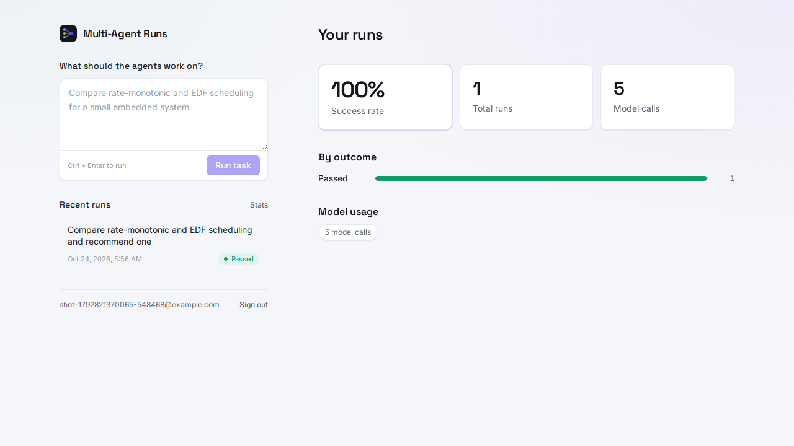

# Multi-Agent AI System

## Software Engineering Course Project Report

---

### Title Page

| Field | Details |
|---|---|
| **Project Title** | Multi-Agent AI System for Reliable Multi-Step Knowledge Tasks |
| **Course Code** | _(course code — fill before submission)_ — Software Engineering |
| **Semester** | _(semester / academic year — fill before submission)_ |
| **Team Members** | |
| | Dhanika Bhat — 24BRS1356 |
| | Ayushi Singh — 24BRS1369 |
| | Yash Gharat — 24BRS1357 |
| **Faculty Guide** | Prof. _(faculty name — fill before submission)_, School of Computer Science and Engineering (SCOPE), Vellore Institute of Technology, Chennai |
| **Submission Date** | _(submission date — fill before submission)_ |

---

## Abstract

This project presents the design, development, and evaluation of a Multi-Agent
AI System that turns a single natural-language task into a verified result by
coordinating several specialised agents rather than relying on one model call.
The system employs an orchestrator-agent architecture in which a central
Orchestrator coordinates specialised autonomous agents — a Planner Agent that
decomposes the task into dependency-ordered sub-tasks, a Research Agent that
gathers grounded information for each sub-task (running independent sub-tasks in
parallel), and a Validator Agent that combines deterministic rule checks with an
LLM-judge score and drives bounded retries when a result falls short.

The project follows an Agile software development lifecycle over a multi-sprint
semester. The backend is implemented in Python (FastAPI, SQLAlchemy, Alembic,
an arq/Redis work queue) and the frontend in React with TypeScript; models are
reached through a single resilient provider layer (circuit breaker, retries with
backoff, usage/cost accounting) that supports Anthropic Claude, OpenAI, and a
free offline Mock used for tests and CI. Testing spans unit, integration, and
end-to-end strategies (pytest and Playwright) with automated CI/CD via GitHub
Actions, including Postgres/Redis integration tests, a container image scan, and
dependency audits.

To evaluate whether the multi-agent approach earns its additional cost, a
benchmark harness runs a fixed task set two ways — a single-agent baseline and
the full pipeline — judged by the same Validator, recording time, pass rate,
quality score, API calls, tokens, and estimated cost; raw results are committed
under `docs/results/`. The report documents the complete lifecycle from
requirements elicitation through design, implementation, testing, and
containerised deployment.

---

## Table of Contents

1. [Introduction](#1-introduction)
2. [Literature Survey / Existing System Analysis](#2-literature-survey--existing-system-analysis)
3. [Software Requirements Specification (SRS)](#3-software-requirements-specification-srs)
4. [System Design](#4-system-design)
5. [Implementation](#5-implementation)
6. [Testing](#6-testing)
7. [Results and Discussion](#7-results-and-discussion)
8. [Project Management Artifacts](#8-project-management-artifacts)
9. [Conclusion and Future Scope](#9-conclusion-and-future-scope)
10. [References](#10-references)
11. [Appendix](#11-appendix)

---

## 1. Introduction

### 1.1 Problem Statement

Large language models answer a prompt in a single pass. For tasks that need
several steps — break the question down, gather information for each part, then
check the combined answer — a single call offers no separation between planning,
retrieval, and verification, no place to ground claims in evidence, and no
mechanism to detect a weak answer and try again. The output is produced and
returned with no internal quality gate, so errors surface only when a human
reads the result. This project addresses the problem of executing multi-step
knowledge tasks reliably: decomposing a task, researching its parts, and
validating the result before returning it, while remaining observable and
extensible enough to run as a real service.

### 1.2 Motivation

Separating concerns is a core software-engineering principle, and it applies to
AI workflows as much as to conventional systems. A monolithic prompt couples
planning, retrieval, and checking into one opaque step that is hard to test,
extend, or reason about. A multi-agent decomposition makes each concern an
independently testable unit with a typed contract, lets independent sub-tasks
run in parallel, and introduces an explicit validation-and-retry loop that a
single call cannot provide. This has academic relevance (it demonstrates
orchestration, dependency scheduling, and self-correction) and practical
relevance (the same structure underlies real research-assistant and
agentic-workflow products). Whether the extra agents justify their added latency
and cost is itself an empirical question, which §7 examines with the benchmark.

### 1.3 Objectives

- **O1:** Design and implement a modular multi-agent architecture with a central orchestrator.
- **O2:** Develop specialised agents (Research, Planner, Validator) that perform autonomous sub-tasks.
- **O3:** Establish inter-agent communication protocols and shared data schemas.
- **O4:** Validate system correctness through comprehensive unit, integration, and system testing.
- **O5:** Deliver the system as a production-grade, observable service — containerised deployment, queue-based execution, authentication with per-user isolation, structured logging, and Prometheus/Grafana metrics — and empirically evaluate the multi-agent pipeline against a single-agent baseline.

### 1.4 Scope

The original scope excluded multi-user access and production deployment. Both
were brought into scope during the project (Phase F); this section lists what
is actually implemented.

**In Scope:**
- Orchestrator-driven multi-agent workflow execution, with dependency-ordered
  parallel research and validator-driven retries
- Research, planning, and validation agents backed by a real LLM (Anthropic
  Claude) or a free offline Mock
- HTTP API and web UI with live progress, cancellation, and run history
- Multiple users with accounts, per-user isolation, and rate limits
- Queue-based execution on separate worker processes (Redis), Postgres storage
- Automated test pipeline via GitHub Actions, including Postgres/Redis integration tests

**Out of Scope:**
- Public internet hosting with uptime guarantees (the system is deployable, but
  is not operated as a public service)
- Independent security penetration testing
- Billing, quotas beyond rate limits, and organisation/team accounts

---

## 2. Literature Survey / Existing System Analysis

### 2.1 Existing Systems and Approaches

| S.No. | System / Framework | Approach | Strengths | Limitations |
|-------|--------------------|----------|-----------|-------------|
| 1 | Auto-GPT (Significant Gravitas) | A single LLM loop that recursively sets its own goals, picks tools, and stores state in memory to pursue an objective autonomously. | Popularised autonomous task loops; large tool ecosystem; fully hands-off operation. | One undifferentiated loop with no separation of planning/validation; prone to looping and drift; little built-in output verification; cost/latency hard to bound. |
| 2 | Microsoft AutoGen | A framework of conversable agents that solve tasks by exchanging messages (e.g. an assistant and a user-proxy/executor). | Flexible multi-agent conversations; code-execution agents; strong research backing. | Conversation-centric rather than a fixed, testable pipeline; emergent control flow is harder to unit-test and reason about; orchestration left largely to the developer. |
| 3 | CrewAI | Role-based agents ("crew") with assigned roles, goals, and sequential or hierarchical task processes. | Clear role abstractions; quick to assemble; readable task definitions. | Heavier framework dependency; validation/self-correction is not a first-class stage; parallelism and retry semantics are limited or implicit. |
| 4 | LangGraph (LangChain) | Agent workflows modelled explicitly as a stateful directed graph of nodes and edges. | General graph model; good for branching/looping flows; built-in state management. | Significant dependency and a second state model; more machinery than a fixed plan→research→validate→retry pipeline needs; a learning curve for a small, well-defined flow. |

### 2.2 Gaps Identified

- **Weak separation of concerns.** Several systems fold planning, retrieval, and checking into one loop or conversation, which is hard to test in isolation and reason about.
- **Limited validation / self-correction.** Output verification is rarely a first-class, configurable stage with an explicit retry policy; most systems return whatever the loop produces.
- **No standard inter-agent contract.** Agents often exchange free-form text or framework-specific objects rather than a single typed schema enforced at every boundary.
- **Cost/latency opacity.** The additional expense of a multi-agent approach is seldom measured against a single-call baseline.

### 2.3 How This Project Addresses the Gaps

Each agent is a separate, independently tested unit behind the abstract `Agent`
contract, so planning, research, and validation are cleanly separated (addresses
gap 1). Validation is a first-class stage: the Validator combines deterministic
rule checks with an LLM-judge score against a configurable threshold, and the
Orchestrator retries up to a bounded number of times before returning a partial
result (gap 2). Every boundary crosses as the typed `AgentRequest`/
`AgentResponse` schemas — never raw dicts — giving one enforced contract (gap 3).
Rather than adopt a general graph engine, the project implements the fixed
plan → research (parallel by dependency level) → validate → retry pipeline in
~200 lines of plain, exhaustively tested Python, and ships a benchmark that
measures the pipeline against a single-agent baseline so the cost/benefit
trade-off is explicit (gap 4).

---

## 3. Software Requirements Specification (SRS)

> *Refer to the detailed standalone SRS document at [`docs/SRS.md`](./SRS.md) for the full specification. Key sections are summarised below.*

### 3.1 Functional Requirements

| Req ID | Requirement | Priority | Module |
|--------|-------------|----------|--------|
| FR-01 | The orchestrator shall accept a user task as input and decompose it into sub-tasks. | High | Orchestrator |
| FR-02 | The Research Agent shall retrieve relevant context data given a query. | High | Research Agent |
| FR-03 | The Planner Agent shall generate a multi-step execution plan from a high-level objective. | High | Planner Agent |
| FR-04 | The Validator Agent shall verify outputs against predefined quality constraints and schemas. | High | Validator Agent |
| FR-05 | The system shall pass structured data between agents using shared Pydantic schemas. | Medium | Shared |
| FR-06 | On validation failure the Orchestrator shall retry the Research→Validate cycle up to `max_retries` times, then return a `status="partial"` result carrying the last aggregated data plus the validation failure reasons, rather than silently discarding partial work. | High | Orchestrator |

### 3.2 Non-Functional Requirements

| Req ID | Category | Requirement |
|--------|----------|-------------|
| NFR-01 | Performance | With the Mock LLM provider, per-agent execution completes in well under 1 second (no network I/O); with a real provider, latency is bounded by that provider's response time plus the retry policy (default `max_retries=3`, exponential backoff). See `docs/SRS.md` NFR-01 for full detail and §7.2 below for measured values once benchmarked. |
| NFR-02 | Scalability | The architecture shall support addition of new agent types without modifying the orchestrator core. |
| NFR-03 | Reliability | The system shall implement retry logic with exponential backoff for LLM API failures. |
| NFR-04 | Maintainability | All modules shall follow PEP 8 coding standards and include docstrings. |
| NFR-05 | Security | API keys and credentials shall never be hard-coded; `.env` files shall be excluded from version control. |

### 3.3 Use Case Diagrams


*Source: [`diagrams/use_case.mmd`](../diagrams/use_case.mmd)*
>

### 3.4 Use Case Descriptions

| Use Case ID | UC-01 |
|---|---|
| **Name** | Submit Task to Orchestrator |
| **Actor(s)** | User |
| **Precondition** | System is running; API keys are configured |
| **Main Flow** | 1. User submits a task string. 2. Orchestrator parses and decomposes the task. 3. Orchestrator delegates sub-tasks to agents. 4. Agents return results. 5. Orchestrator aggregates and returns final output. |
| **Postcondition** | User receives aggregated result. |
| **Alternate Flow** | If an agent fails, orchestrator retries or returns partial result with error. |

| Use Case ID | UC-02 |
|---|---|
| **Name** | Submit and Poll a Task via the HTTP API |
| **Actor(s)** | Developer / Researcher (HTTP client) |
| **Precondition** | The FastAPI app is running; database initialised. |
| **Main Flow** | 1. Client `POST /tasks` with `{"task": "..."}`. 2. API returns `status="pending"` immediately and runs the pipeline in the background. 3. Client polls `GET /tasks/{id}` until a terminal status. |
| **Postcondition** | Final result/error, retry count, and step trace are persisted and retrievable by id. |
| **Alternate Flow** | Empty task string → HTTP 422. Unknown id → HTTP 404. Pipeline crash → task marked `status="error"` rather than stuck pending. |

### 3.5 Hardware and Software Requirements

**Hardware Requirements:**

| Component | Specification |
|-----------|--------------|
| Processor | Intel i5 / AMD Ryzen 5 or equivalent |
| RAM | 8 GB minimum |
| Storage | 5 GB free disk space |
| Network | Internet connectivity (for LLM API calls) |

**Software Requirements:**

| Component | Specification |
|-----------|--------------|
| Operating System | Windows 10+, macOS 12+, or Ubuntu 20.04+ |
| Programming Language | Python 3.10+ |
| Package Manager | pip / venv |
| Version Control | Git 2.30+, GitHub |
| CI/CD | GitHub Actions |
| Testing Framework | pytest 7.4+ |
| Key Libraries | pydantic, pydantic-settings, FastAPI, SQLAlchemy, uvicorn; optional `openai` SDK |
| Frontend | Node.js 22, React 18, TypeScript 5, Vite 5, Tailwind CSS 3, TanStack React Query 5 |

---

## 4. System Design

### 4.1 Architecture Diagram


*Source: [`diagrams/architecture.mmd`](../diagrams/architecture.mmd)*
>

```
┌─────────────────────────────────────────────────────┐
│                      USER                           │
│                   (Task Input)                      │
└──────────────────────┬──────────────────────────────┘
                       │
                       ▼
┌──────────────────────────────────────────────────────┐
│                  ORCHESTRATOR                        │
│  ┌─────────────┐  ┌──────────┐  ┌───────────────┐   │
│  │ Task Parser  │  │ Workflow │  │ State Manager │   │
│  │             │  │ Engine   │  │               │   │
│  └─────────────┘  └──────────┘  └───────────────┘   │
└──────┬──────────────┬──────────────────┬─────────────┘
       │              │                  │
       ▼              ▼                  ▼
┌────────────┐ ┌────────────┐  ┌──────────────────┐
│  Research   │ │  Planner   │  │    Validator      │
│  Agent      │ │  Agent     │  │    Agent          │
└──────┬─────┘ └──────┬─────┘  └────────┬─────────┘
       │              │                  │
       ▼              ▼                  ▼
┌─────────────────────────────────────────────────────┐
│              SHARED (schemas, utils, config)         │
└─────────────────────────────────────────────────────┘
```

### 4.2 Sequence Diagrams


*Source: [`diagrams/sequence.mmd`](../diagrams/sequence.mmd)*
>

**Example Mermaid Source (for reference):**



### 4.3 Activity Diagram


*Source: [`diagrams/activity.mmd`](../diagrams/activity.mmd)*
>

### 4.4 Data Flow Diagrams

#### DFD Level 0 (Context Diagram)


*Source: [`diagrams/dfd_level0.mmd`](../diagrams/dfd_level0.mmd)*
>

#### DFD Level 1


*Source: [`diagrams/dfd_level1.mmd`](../diagrams/dfd_level1.mmd)*
>

### 4.5 Class Diagram


*Source: [`diagrams/class.mmd`](../diagrams/class.mmd)*
>



### 4.6 Database / Data Schema Design

Inter-agent data transfer within a single pipeline run uses in-memory Pydantic
schemas (`AgentRequest`, `AgentResponse`, `RunResult`) as described above.
The API persists runs with SQLAlchemy (`src/shared/db.py`) in SQLite for
development and Postgres in deployment. The schema is versioned with Alembic
(`migrations/`), and a test fails if the models and migrations disagree.

**`users`** — accounts: `id` (PK), `email` (unique, lower-cased), `password_hash`
(bcrypt), `created_at`.

**`tasks`** — one row per orchestrator run (`user_id` → `users.id`, indexed, so
each user sees only their own runs):

| Column | Type | Description |
|--------|------|--------------|
| `id` | String (PK) | UUID identifying the run; returned to the API client. |
| `input_task` | String | The original task string submitted. |
| `status` | String | `pending` (queued) → `running` → `success` / `partial` / `error` / `cancelled`. |
| `result_json` | JSON | The aggregated result dict (null until the run completes). |
| `error` | String | Error or partial-failure explanation, if any. |
| `retries_used` | Integer | How many validation-retry cycles ran. |
| `cancel_requested` | Boolean | Set by `POST /tasks/{id}/cancel`; checked by the run between stages. |
| `created_at` / `updated_at` | DateTime (tz) | Timestamps, auto-managed; `created_at` indexed for listing. |

**`run_steps`** — one row per agent step, written as the step finishes (this is
what the live event stream reads):

| Column | Type | Description |
|--------|------|--------------|
| `id` | Integer (PK) | Surrogate key. |
| `task_id` | String (FK → tasks.id, cascade delete, indexed) | Owning run. |
| `seq` | Integer | Order the step finished in (1, 2, …); unique per task; used as the SSE event id. |
| `step_name`, `status` | String | Agent (`planner`/`research`/`validator`) and outcome. |
| `latency_seconds` | Float | Wall-clock time of the step. |
| `sub_task_id` | String | Which sub-task a research step belongs to. |
| `detail`, `usage` | JSON | Error detail; LLM calls/retries/tokens/cost. |

SQLite needs no setup for development and tests; Postgres is used in Docker
Compose, and CI runs the database tests against both.

---

## 5. Implementation

### 5.1 Technology Stack Justification

| Technology | Purpose | Justification |
|------------|---------|---------------|
| Python 3.10+ | Primary language | Widely supported, strong AI/ML ecosystem, team familiarity |
| Pydantic v2 | Data validation & schemas | Type-safe, fast, enforces contracts between agents |
| pytest | Testing framework | Industry standard for Python, rich plugin ecosystem |
| GitHub Actions | CI/CD pipeline | Free for public repos, native GitHub integration |
| python-dotenv | Config management | Secure handling of API keys and environment variables |
| LLM provider abstraction (`src/shared/llm_provider.py`) | AI capabilities | Agents depend on an `LLMProvider` interface, not a vendor SDK. The default deterministic **Mock** provider lets the whole pipeline, its tests, and demos run offline with no API key or cost; the optional **OpenAI** provider (`LLM_PROVIDER=openai`) is loaded only when selected, so the SDK is not a hard dependency. |
| FastAPI + SQLAlchemy (SQLite) | HTTP API and persistence | Typed request/response validation via the same Pydantic models used internally; SQLite needs no server for local use or CI, and `DATABASE_URL` allows a later move to Postgres. |
| React + Vite + Tailwind + React Query | Web UI | React Query handles polling a running task and caching run history; Vite gives fast builds; Tailwind keeps the small design system (colors, type) in one config. |

### 5.2 Module-wise Description

#### 5.2.1 Orchestrator (`src/orchestrator/`)

The Orchestrator module is the system's entry point. It receives a user task, coordinates the execution pipeline across agents, manages state transitions, and aggregates final results.

**Key Responsibilities:**
- Task parsing and decomposition
- Agent dispatch and sequencing
- Error handling and retry logic
- Result aggregation

#### 5.2.2 Research Agent (`src/agents/research_agent/`)

Gathers grounded information for one sub-task. It takes an `AgentRequest` whose
objective is the sub-task query, optionally retrieves context from a pluggable
`SearchTool` (the free Wikipedia search by default, or a `NullSearchTool` in
tests), passes that context to the model through `call_llm()`, and returns an
`AgentResponse` whose data holds the findings plus token/cost usage. Independent
sub-tasks are dispatched in parallel by the Orchestrator, so the agent itself
stays single-purpose and stateless.

#### 5.2.3 Planner Agent (`src/agents/planner_agent/`)

Decomposes the objective into an ordered list of sub-tasks. It prompts the model
for a JSON plan in which each sub-task carries an `id` and a `depends_on` list,
parses the output defensively (`extract_json_object` + `Plan` validation), and
makes one repair attempt before failing cleanly if the model returns unusable
JSON. The `depends_on` edges are what let the Orchestrator schedule independent
sub-tasks concurrently while respecting ordering.

#### 5.2.4 Validator Agent (`src/agents/validator_agent/`)

Judges the aggregated result. It first applies deterministic rule checks (e.g.
non-empty findings for every sub-task), then asks the model for a JSON judgement
`{score 0–1, reasons}` against a short rubric. A result passes only when the
rules pass **and** the judge score meets the configurable `judge_threshold`.
The status and score are returned on the `AgentResponse`, and the Orchestrator
uses them to decide whether to accept the result or retry.

#### 5.2.5 Shared Module (`src/shared/`)

Contains cross-cutting concerns shared by all components:
- `schemas.py` — Pydantic models (`AgentRequest`, `AgentResponse`) defining the inter-agent data contract.
- `utils.py` — Logging setup, retry helpers, and formatting utilities.
- `config.py` — Application settings loaded from environment variables via `pydantic-settings`.

### 5.3 Key Algorithms and Logic

**Dependency-level scheduling (parallel research).** The Planner's sub-tasks
form a dependency graph via `depends_on`. `dependency_levels()` groups them into
levels by a topological pass: level *k* contains every sub-task whose
dependencies all appear in earlier levels. The Orchestrator executes one level
at a time, running the independent sub-tasks within a level concurrently through
a thread pool (bounded by `max_parallel_research`), so independent work overlaps
while ordering is preserved.

**Validate-and-retry loop.** After research, the Orchestrator aggregates the
findings and invokes the Validator. If the result fails (rules fail or the judge
score is below threshold), it retries the research/validate cycle up to
`max_retries` times; when retries are exhausted it returns the best partial
result together with the validation errors, never raising to the caller.

**Resilient model calls.** Every agent reaches a model only through
`Agent.call_llm()`, which delegates to `generate_with_resilience`: a retry with
exponential backoff for transient errors, a shared circuit breaker that fails
fast after repeated provider failures, a per-call timeout, and usage/cost
accounting. This centralises the reliability patterns so no agent can bypass
them.

---

## 6. Testing

> *Refer to the detailed test plan at [`docs/test_plan.md`](./test_plan.md).*

### 6.1 Testing Strategy

| Level | Scope | Tool | Location |
|-------|-------|------|----------|
| Unit Testing | Individual agent methods, utility functions, schema validation | pytest | `tests/test_agents.py`, `tests/test_orchestrator.py` |
| Integration Testing | End-to-end pipeline with mocked LLM responses | pytest | `tests/test_integration.py` |
| End-to-End / System Testing | Full stack (UI → API → queue → worker → DB) driven through the browser | Playwright | `frontend/e2e/app.spec.ts` (run by the `e2e` CI job against the Compose stack) |

### 6.2 Test Cases

> *See `docs/test_plan.md` §3 for the full, detailed test-case table (UT-*/IT-*/ST-*). Summary below.*

| Test ID | Module | Test Description | Input | Expected Output | Actual Output | Status |
|---------|--------|-----------------|-------|-----------------|---------------|--------|
| TC-01 | Orchestrator | Orchestrator initialises without errors | N/A | Orchestrator object created | Created with default agents | Pass |
| TC-02 | Research Agent | `execute()` returns structured `AgentResponse` | `AgentRequest(prompt="test query")` | `status="success"` with findings | Confirmed (see test_plan.md UT-R-01) | Pass |
| TC-03 | Planner Agent | `create_plan()` returns a `Plan` with sub-tasks | `"test objective"` | `Plan` instance, 3 sub-tasks | Confirmed (see test_plan.md UT-P-01/02) | Pass |
| TC-04 | Validator Agent | `validate()` returns `ValidationStatus.PASS` for valid input | `{"st-1": {"findings": "ok"}}` | `PASS` | Confirmed (see test_plan.md UT-V-01) | Pass |
| TC-05 | Integration | Full pipeline completes without exception | Complete task string | Aggregated `RunResult` | `status="success"` (see test_plan.md IT-04) | Pass |

### 6.3 Code Coverage

Measured with `pytest --cov=src` in GitHub Actions (run
[39715518771](https://github.com/yashg2006/MultiAgent/actions/runs/39715518771),
commit `c146082`): **98% line coverage (1440 statements, 33 missed)** across
165 backend test functions, against the CI gate of ≥ 80%. The same CI run
executes the full suite a second time against real Postgres and Redis service
containers (66/66 integration tests passing). Every module-level target in
`docs/test_plan.md` §6 is met; the full per-module table is there.

CI now publishes the coverage total and per-module breakdown as annotations on
every pull request, so this number stays visible as the code changes.

---

## 7. Results and Discussion

### 7.1 Screenshots / Sample Outputs

The screenshots below are captured from the running application by the `screenshots` job of the Evidence workflow (`.github/workflows/evidence.yml`), which drives the real UI with Playwright and commits the images to `docs/assets/screenshots/` — nothing is mocked or staged.











### 7.2 Benchmark: single-agent vs. multi-agent

To test whether the multi-agent pipeline earns its extra cost, `scripts/benchmark.py`
runs a fixed set of 15 varied tasks two ways — a single-agent baseline (one model
call) and the full pipeline — and judges **both** with the same Validator so the
quality scores are directly comparable. It records, per task and approach,
wall-clock time, validator pass rate, judge score, LLM calls, tokens, and
estimated cost. The run is driven by the `Evidence` workflow
(`.github/workflows/evidence.yml`): with the `ANTHROPIC_API_KEY` secret set it
uses Claude (`claude-haiku-5-5`), otherwise it falls back to the free Mock
provider. Raw results are committed to `docs/results/` and the table/chart below
are generated from them by `scripts/report_benchmark.py` — no number here is
hand-entered.


*(The chart shows the latest committed run. With `ANTHROPIC_API_KEY` set, the Evidence workflow instead produces `benchmark-anthropic.png` with real quality and cost figures.)*

*Table: [`docs/results/benchmark-mock.md`](results/benchmark-mock.md)
(or `benchmark-anthropic.md` when the Evidence workflow is run with an API key). These files are produced by the
Evidence workflow; run it once to populate them.*

### 7.3 Performance Characteristics

| Metric | Source |
|--------|--------|
| Task completion time, pass rate, judge score, calls, tokens, cost | Benchmark results in `docs/results/` (§7.2) |
| Throughput / latency under concurrent load | Locust load test, `docs/results/loadtest*` (Evidence workflow) |
| Test coverage | `pytest --cov=src` in CI; gate ≥ 80% (see §6.3) |

### 7.4 Discussion

The multi-agent pipeline is expected to trade higher latency and cost — it makes
several model calls per task (plan, one per sub-task, validate, and retries)
versus one for the baseline — for better-grounded, verified answers and an
explicit quality gate. The benchmark quantifies exactly this trade-off; the
numbers live in `docs/results/` so the claim can be checked rather than asserted.

What worked well: the typed `AgentRequest`/`AgentResponse` contract made agents
independently testable and kept the Orchestrator agnostic to which agents it
runs (NFR-02); the single resilient call path meant retries, the circuit breaker,
and cost accounting were implemented once and applied everywhere; and the Mock
provider made the entire test and CI pipeline free, fast, and deterministic.

Challenges: real-model output is non-deterministic, so the Planner's JSON parsing
needed a defensive repair step and all tests had to use the Mock or recorded
fixtures rather than live calls; and streaming live progress (SSE) required
replacing the buffering middleware with a plain ASGI implementation. Against the
objectives of §1.3, O1–O4 are met in full and O5 is met through the containerised,
observable deployment and the benchmark described above.

---

## 8. Project Management Artifacts

### 8.1 Gantt Chart / Sprint Plan

> *Refer to the detailed sprint logs at [`docs/sprint_logs.md`](./sprint_logs.md).*

| Sprint | Weeks | Planned Tasks | Assigned To | Status |
|--------|-------|---------------|-------------|--------|
| Sprint 1 | 1–2 | Project setup, SRS draft, repo scaffolding | All | Completed |
| Sprint 2 | 3–4 | Architecture design, agent interface definitions | Dhanika Bhat, Ayushi Singh | Completed |
| Sprint 3 | 5–7 | Core orchestrator + Research Agent implementation | Dhanika Bhat | Completed |
| Sprint 4 | 8–10 | Planner + Validator Agent implementation | Ayushi Singh, Yash Gharat | Completed |
| Sprint 5 | 11–12 | Integration testing, bug fixes | All | Completed |
| Sprint 6 | 13–14 | System testing, documentation, report writing | All | Completed |
| Sprint 7 | 15 | Final submission, presentation prep | All | Completed |

### 8.2 Task Allocation

| Team Member | Primary Responsibility | Secondary Responsibility |
|-------------|----------------------|-------------------------|
| Dhanika Bhat | Orchestrator module, system integration | Architecture design, CI/CD |
| Ayushi Singh | Research Agent, Planner Agent | SRS documentation |
| Yash Gharat | Validator Agent, testing framework | Test plan, final report |

### 8.3 Risk Analysis

| Risk ID | Risk Description | Probability | Impact | Mitigation Strategy |
|---------|-----------------|-------------|--------|---------------------|
| R-01 | LLM API rate limits or downtime | Medium | High | Implement retry logic with exponential backoff; cache responses during development |
| R-02 | Scope creep due to feature additions | High | Medium | Freeze scope after Sprint 2; use change request process |
| R-03 | Team member unavailability during exams | Medium | Medium | Front-load critical implementation; maintain detailed documentation |
| R-04 | Integration failures between agents | Medium | High | Define shared schemas early; continuous integration testing |
| R-05 | No local runtime in the dev sandbox — bugs only surface in CI | Medium | Medium | Keep PRs small; rely on rich CI annotations and the Mock provider so every change is verifiable in CI |

---

## 9. Conclusion and Future Scope

### 9.1 Conclusion

The project delivered a working, production-grade multi-agent AI system built on an orchestrator-agent architecture. A central Orchestrator coordinates a Planner, Research, and Validator agent to turn a single task into a verified result, with dependency-ordered parallel research and a validate-and-retry loop. All five objectives of §1.3 were met: the modular architecture (O1) and specialised agents (O2) are implemented behind a typed inter-agent contract (O3); correctness is covered by unit, integration, and end-to-end tests with a CI coverage gate (O4); and the system is delivered as a containerised, observable, multi-user service with a benchmark that measures the multi-agent approach against a single-agent baseline (O5). The process followed Agile sprints with feature branches, conventional commits, pull requests, and a CI pipeline that enforces linting, type-checking, tests, security scanning, and end-to-end checks on every change.

### 9.2 Future Scope

- **Agent Expansion:** Add new specialised agents (e.g., Code Generation Agent, Summarisation Agent) without modifying the orchestrator core.
- **Persistent Memory:** Implement agent memory/context windows for multi-turn task execution.
- **Persistent agent memory:** multi-turn tasks where later runs reuse context from earlier ones.
- **Response caching:** a Redis-backed cache keyed on (model, system, prompt) to cut cost and latency on repeated sub-tasks.
- **Richer retrieval:** additional `SearchTool` implementations (web search, document stores) beyond the current Wikipedia grounding.
- **Cloud hosting:** deploy the existing Compose stack to managed infrastructure with uptime guarantees (currently deployable but not operated as a public service).
- **Human-in-the-loop review:** an optional approval step before a result is returned for high-stakes tasks.

---

## 10. References

[1] Q. Wu, G. Bansal, J. Zhang, Y. Wu, B. Li, E. Zhu, L. Jiang, X. Zhang, S. Zhang, J. Liu, A. H. Awadallah, R. W. White, D. Burger, and C. Wang, "AutoGen: Enabling Next-Gen LLM Applications via Multi-Agent Conversation," 2023. [Online]. Available: https://arxiv.org/abs/2308.08155

[2] S. Yao, J. Zhao, D. Yu, N. Du, I. Shafran, K. Narasimhan, and Y. Cao, "ReAct: Synergizing Reasoning and Acting in Language Models," in *Proc. Int. Conf. on Learning Representations (ICLR)*, 2023. [Online]. Available: https://arxiv.org/abs/2210.03629

[3] Significant Gravitas, "AutoGPT," GitHub repository, 2023. [Online]. Available: https://github.com/Significant-Gravitas/AutoGPT

[4] LangChain, "LangGraph Documentation," 2024. [Online]. Available: https://langchain-ai.github.io/langgraph/

[5] S. Ramírez, "FastAPI Documentation," [Online]. Available: https://fastapi.tiangolo.com/

[6] Pydantic, "Pydantic v2 Documentation," [Online]. Available: https://docs.pydantic.dev/

[7] Meta Open Source, "React Documentation," [Online]. Available: https://react.dev/

[8] pytest Development Team, "pytest Documentation," [Online]. Available: https://docs.pytest.org/

[9] Python Software Foundation, "Python 3.10 Documentation," [Online]. Available: https://docs.python.org/3.10/

---

## 11. Appendix

### Appendix A: GitHub Repository

- **Repository URL:** https://github.com/yashg2006/MultiAgent
- **Branch Strategy:** `main` (stable), `develop` (integration), `feature/*` (feature branches)
- **Commit History:** [Refer to repository for full commit log demonstrating version control discipline]

### Appendix B: Environment Configuration

See `.env.example` in the repository root for required environment variables.

### Appendix C: Full Code Listing

> *[If required by the rubric, include full source code listings here. Otherwise, reference the GitHub repository.]*
>
> Full source code is available at the GitHub repository linked in Appendix A. Key modules:
> - `src/orchestrator/main.py`
> - `src/agents/research_agent/agent.py`
> - `src/agents/planner_agent/agent.py`
> - `src/agents/validator_agent/agent.py`
> - `src/shared/schemas.py`

### Appendix D: Meeting Minutes

> *[Refer to `docs/sprint_logs.md` for complete meeting records.]*
